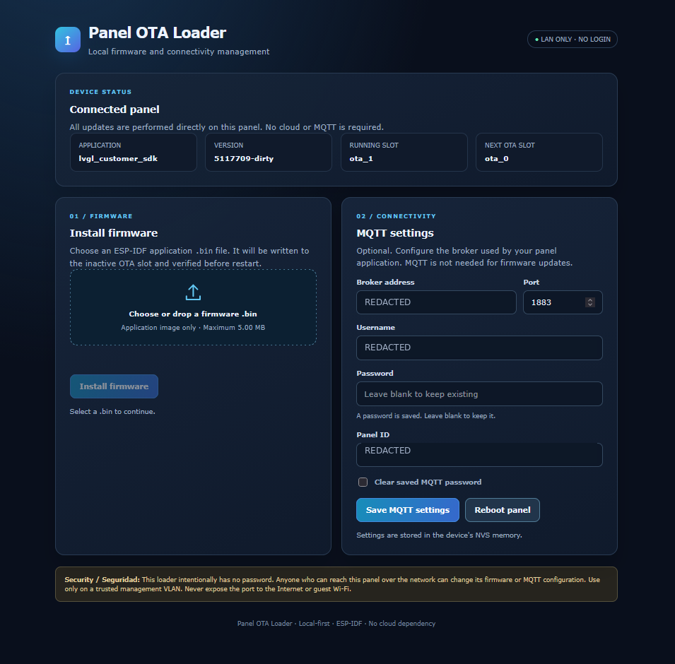
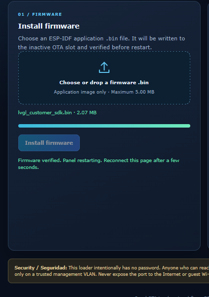
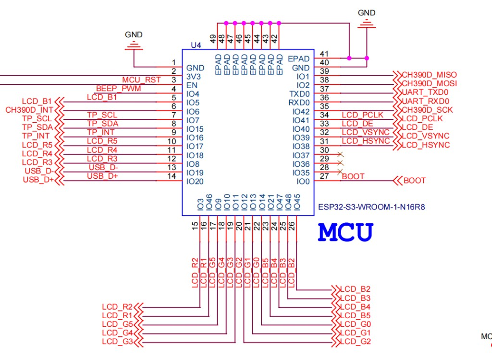
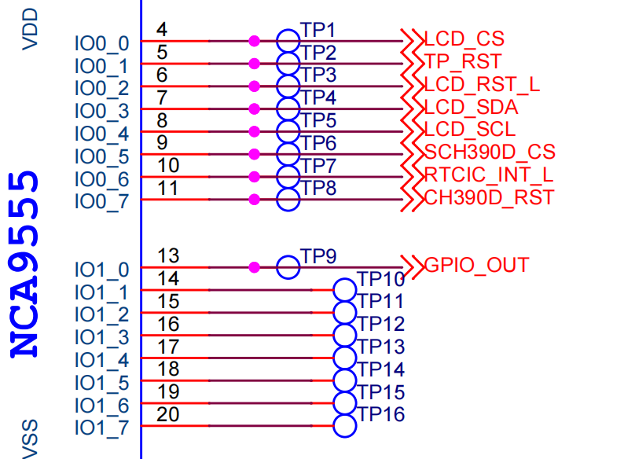
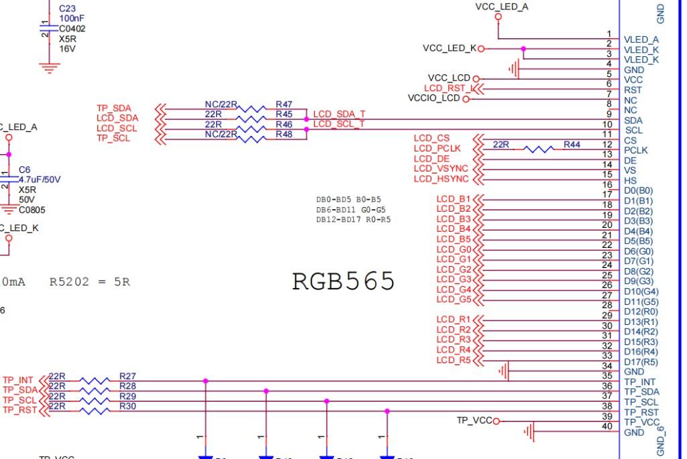
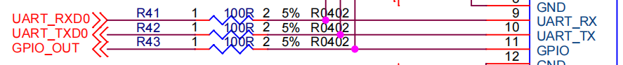

# YC-SM43P ESP32-S3 Hub UI SDK

**Organization:** [portworld-solu](https://github.com/portworld-solu)  
**Product:** YC-SM43P · ESP32-S3 · 480×480 RGB Hub panel · LVGL 8 · ESP-IDF 5.5.x  

Open-source customer firmware for a smart Hub HMI: display/touch bring-up, Wi‑Fi + Bemfa MQTT, BLE/Mesh, RS485/Modbus helpers, and ten Hub UI themes — all as **editable C sources** (no sealed `.a`).

---

## Highlights

| Item | Detail |
|------|--------|
| MCU | ESP32-S3-WROOM-1-N16R8 (16 MB Flash · 8 MB PSRAM) |
| Display | ST7701S RGB565 · **480×480** · GT911 touch |
| IO expander | **NCA9555** (LCD 3-wire SPI / RST / TP_RST / ETH CS·RST / GPIO_OUT) |
| Optional ETH | CH390D (SPI) |
| UI | Ten Hub themes (`slate` default) + SPIFFS icons |
| Connectivity | Wi‑Fi STA, Bemfa MQTT, BLE / Mesh |
| Field bus | RS485 / Modbus APIs (`main/app`) |

---

## Web-based OTA firmware updates (ESP32-S3)

The optional **Panel OTA Loader** component adds a local browser interface for application firmware updates over Ethernet/Wi-Fi. Upload a compatible ESP-IDF **application `.bin`** directly to the device; the firmware is validated, written to the inactive OTA partition and then the panel automatically restarts. No MQTT broker, cloud service, or USB cable is involved in subsequent application updates.





**Requirements:** the initial firmware must already include the loader (installed once over USB, or preferably provisioned by the manufacturer), a partition table with `ota_0` and `ota_1`, and an IP connection to the panel. The loader updates **application images only**; do not upload merged-flash images, bootloaders, partition tables, or SPIFFS images.

The web UI also offers optional MQTT broker/user/password storage in an NVS namespace. **The factory MQTT client must be adapted to consume these settings**; storing values alone does not change its connection configuration.

**Security:** the current lab-tested loader intentionally has **no login**, so it must be explicitly enabled on an isolated and trusted management LAN. Never expose TCP/80 to the internet, a guest VLAN, or other untrusted clients. The password is hidden from GET responses but is provisioned over HTTP, not encrypted in transit. See [OTA Loader documentation](docs/OTA_LOADER.md) for installation, limitations and evidence.

**Espressif references:** [Native OTA API](https://docs.espressif.com/projects/esp-idf/en/v5.5.1/esp32s3/api-reference/system/ota.html) and [HTTPS OTA](https://docs.espressif.com/projects/esp-idf/en/v5.5.1/esp32s3/api-reference/system/esp_https_ota.html). The web uploader uses the **native OTA APIs**; `esp_https_ota` is a complementary approach for device-initiated HTTPS downloads, not the upload path implemented here.

---

## Hardware reference

Firmware pin defaults live in `config/sdkconfig.board.395hsd.defaults` and [docs/BOARD_PINOUT.md](docs/BOARD_PINOUT.md). Schematics below match the YC-SM43P board.

### MCU · ESP32-S3



RGB data/sync, TP I2C, CH390 SPI, UART0, backlight PWM (GPIO4).

### NCA9555 expander



| Expander | Net | Role |
|----------|-----|------|
| P0.0 | LCD_CS | Panel 3-wire SPI CS |
| P0.1 | TP_RST | Touch reset |
| P0.2 | LCD_RST_L | Panel reset |
| P0.3 / P0.4 | LCD_SDA / LCD_SCL | 3-wire SPI |
| P0.5 / P0.7 | SCH390D_CS / CH390D_RST | Ethernet |
| P0.6 | RTCIC_INT_L | RTC IRQ (input) |
| P1.0 | GPIO_OUT | General out / RS485 DE |

### LCD · RGB565 connector



### UART / GPIO header



---

## Repository map

```text
YC-SM43P-ESP32-S3/
├── components/
│   ├── board_bsp/     # RGB / GT911 / NCA9555 / CH390 / backlight (source)
│   ├── hub_core/      # hub_model
│   ├── cloud_wifi/    # Wi-Fi + Bemfa MQTT
│   ├── bt_ctrl/       # BLE / Mesh
│   └── …
├── main/              # app boot, hub_ui, RS485/Modbus helpers
├── ui/themes/         # Hub theme packs
├── spiffs_image/      # Icons (flash storage partition!)
├── config/            # Board + common sdkconfig defaults
├── lvgl-front/        # Browser UI preview kit (optional)
└── docs/              # Pinout, architecture, schematics
```

---

## Quick start

**Requirements:** [ESP-IDF 5.5.x](https://docs.espressif.com/projects/esp-idf/en/v5.5.1/esp32s3/), target **esp32s3**.

```powershell
git clone https://github.com/portworld-solu/YC-SM43P-ESP32-S3.git
cd YC-SM43P-ESP32-S3

# optional: pick theme in main/app_ui_theme_select.h  (APP_UI_THEME_SLATE, …)

idf.py set-target esp32s3
idf.py build
idf.py -p COMx flash monitor
```

Flash must include the **storage (SPIFFS)** partition or icons stay blank.

### Theme preview in browser

```bash
cd lvgl-front
npx serve .
```

---

## Documentation (slim)

| Doc | Contents |
|-----|----------|
| [docs/BOARD_PINOUT.md](docs/BOARD_PINOUT.md) | Software pin table + schematics |
| [docs/ARCHITECTURE_EN.md](docs/ARCHITECTURE_EN.md) | Layered architecture |
| [docs/LAYERED_SDK.md](docs/LAYERED_SDK.md) | Component ownership |
| [main/STRUCTURE.md](main/STRUCTURE.md) | `main/` layout |

---

## Design rules

- **`hub_model`** is the single source of truth for Hub device state.
- Never block on RS485 / Modbus inside LVGL callbacks — use a FreeRTOS bus-bridge task (`main/app/examples/`).
- Prefer editing `ui/themes/` and `main/app` for product work; edit `board_bsp` when bringing up hardware.

---

## Links

- GitHub org: https://github.com/portworld-solu  
- This repo: https://github.com/portworld-solu/YC-SM43P-ESP32-S3  
