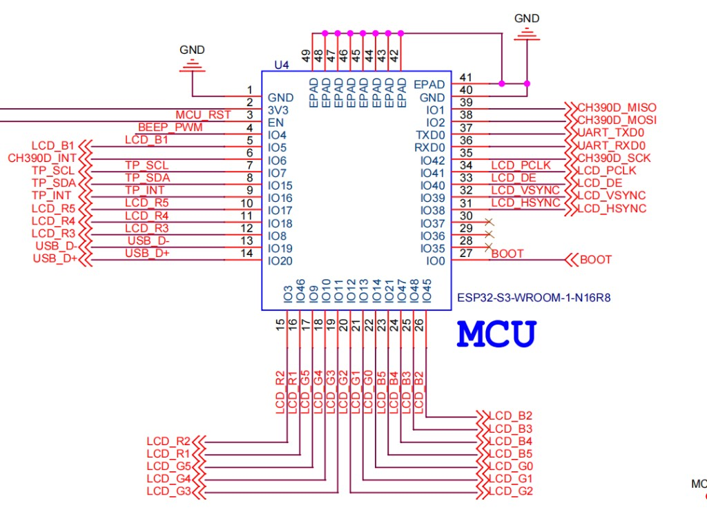
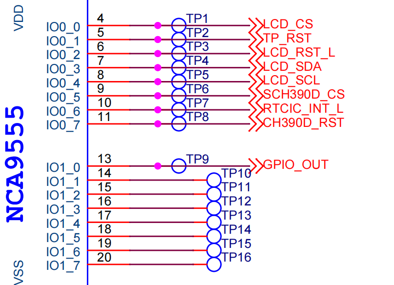
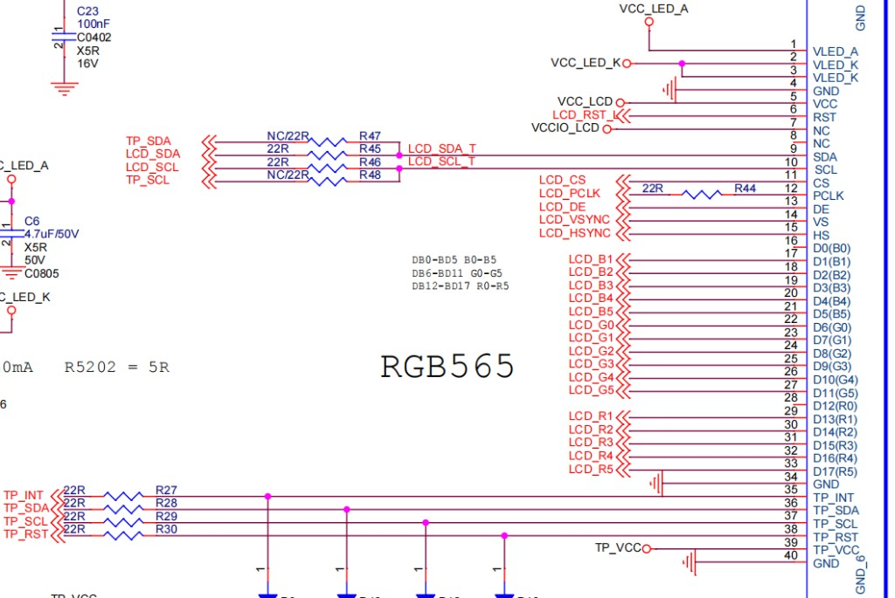
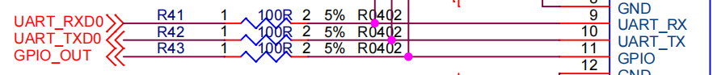

# YC-SM43P / 395HSD — board pins & panel

Software defaults: `config/sdkconfig.board.395hsd.defaults`  
Expander bit map: `components/board_bsp/include/board_io_expander.h`  
RGB / touch bring-up: `components/board_bsp/src/withthewind_board_lvgl_init.c`

## Schematics

| Figure | File |
|--------|------|
| ESP32-S3 MCU | [images/mcu_esp32s3_pinout.png](images/mcu_esp32s3_pinout.png) |
| NCA9555 expander | [images/nca9555_expander.png](images/nca9555_expander.png) |
| LCD RGB565 connector | [images/lcd_rgb565_connector.png](images/lcd_rgb565_connector.png) |
| UART / GPIO header | [images/uart_gpio_connector.png](images/uart_gpio_connector.png) |

## Display (firmware)

| Item | Value |
|------|-------|
| Panel | ST7701S RGB parallel |
| Color | RGB565 |
| Resolution | 480 × 480 |
| Touch | GT911 (I2C) |
| TP I2C SCL / SDA | **GPIO7 / GPIO15** (shared with NCA9555) |
| Backlight | MCU **GPIO4** LEDC PWM |
| Framebuffers | 3 FB + avoid_tear + bounce_h=40 |

## RGB data / sync (MCU GPIO — firmware)

| Signal | GPIO | Notes |
|--------|------|-------|
| DATA0–4 (B) | 5, 45, 48, 47, 21 | LSB = DATA0 |
| DATA5–10 (G) | 14, 13, 12, 11, 10, 9 | |
| DATA11–15 (R) | 46, 3, 8, 18, 17 | |
| VSYNC | 39 | |
| HSYNC | 38 | |
| DE | 40 | |
| PCLK | 41 | |
| DISP | -1 | unused |

## NCA9555 (I2C 0x20)

| Bit | Net | Role |
|-----|-----|------|
| P0.0 | LCD_CS | Panel 3-wire SPI CS |
| P0.1 | TP_RST | Touch reset |
| P0.2 | LCD_RST_L | Panel reset |
| P0.3 | LCD_SDA | 3-wire SPI data |
| P0.4 | LCD_SCL | 3-wire SPI clock |
| P0.5 | SCH390D_CS | Ethernet CS |
| P0.6 | RTCIC_INT_L | RTC interrupt (input, active low) |
| P0.7 | CH390D_RST | Ethernet reset |
| P1.0 | GPIO_OUT | General output / RS485 DE |
| P1.1 | BEEP | Buzzer (active high) |

## CH390 Ethernet (SPI)

| Signal | Connection |
|--------|------------|
| SPI host | SPI3 |
| MISO / MOSI / SCLK | GPIO1 / GPIO2 / GPIO42 |
| CS / RST | NCA9555 P0.5 / P0.7 |
| INT | GPIO6 |

## How to change pins

1. Edit `config/sdkconfig.board.395hsd.defaults`, then `idf.py fullclean` + `reconfigure`.
2. Or `idf.py menuconfig` → **Board: RGB LCD** / **CH390** / **NCA9555**.
3. Expander macros: `board_io_expander.h`, then full rebuild.
